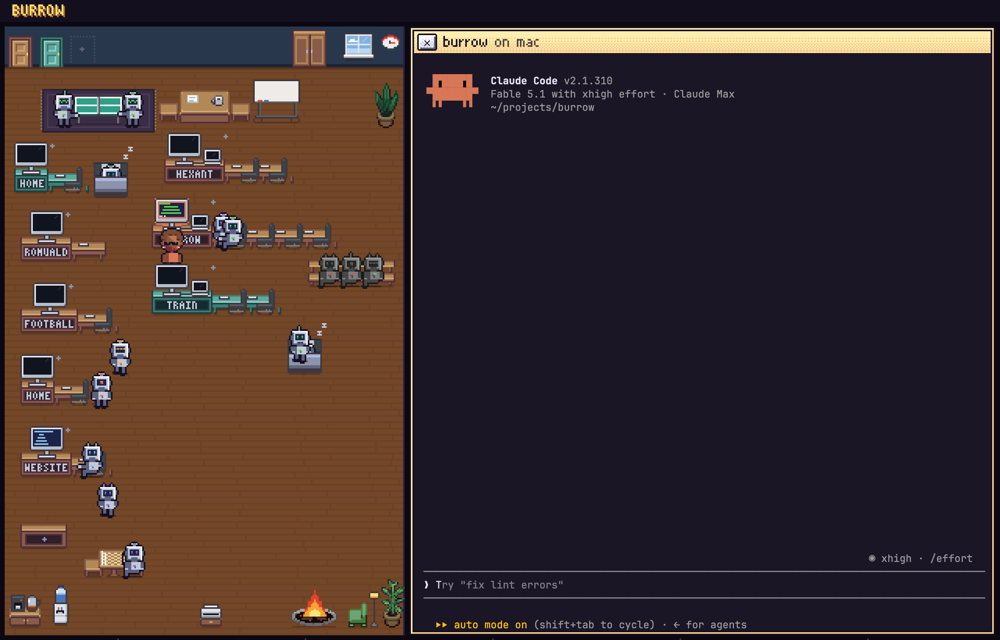
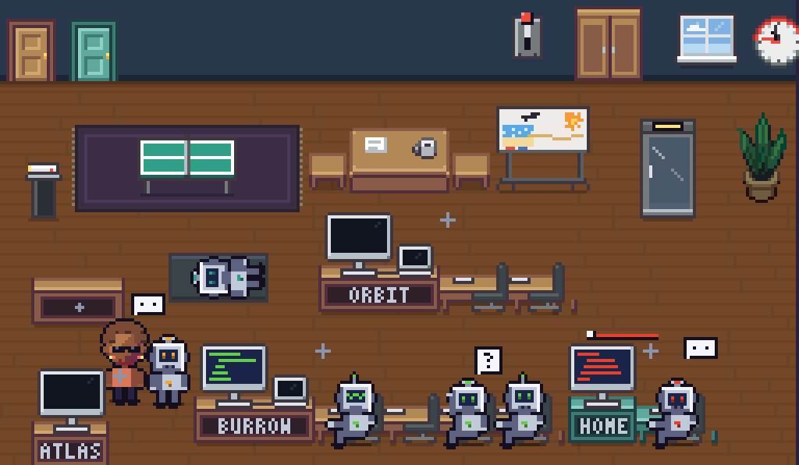
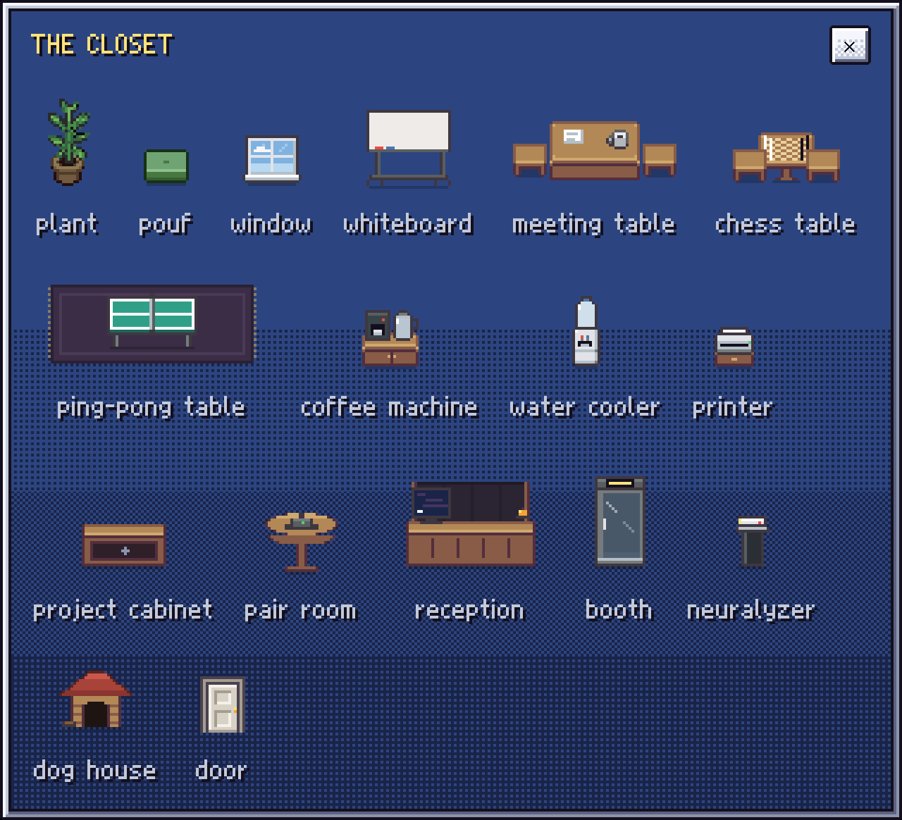
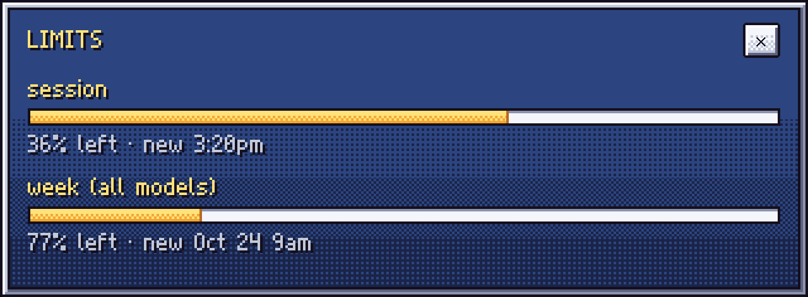

# burrow

A room for your Claude Code sessions.



Every Claude Code session running in the background on your machines is a robot in one room. What a
session is doing is where its robot is and what it does. What you want done with a session, you do to its
robot. Click one and its session opens beside the room, in a real terminal.

## First principles

**burrow owns nothing.** The sessions are Claude Code's own background sessions (`claude --bg`), and
burrow is a view on them: it runs `claude agents`, `claude attach`, `claude stop` and `claude rm` on your
machines, over your own ssh for the remote ones, and nothing else. Close burrow and every session keeps
running; open it again and they are all there. Nothing is installed on a machine but Claude Code.

**The room is the interface.** Every state Claude Code has is shown by something in the room, and every
action is something you do in the room. There are no notifications, badges, counters or sounds, and no
buttons where a gesture will do: a session that needs you sits with its hand up, you stop one by carrying
its robot to the bench, and your usage limits are the coffee pot and the water bottle.

**The terminal is Claude Code's own.** A click on a robot runs `claude attach` in a terminal next to the
room. Nothing of Claude Code is re-implemented, so whatever it can do, you can do here.

**One room, all your machines.** The machines are Claude Code's ssh connections (`sshConfigs` in
`~/.claude/settings.json`), one door each in the wall. The desks are the directories you put on the
floor; a session is in the room while its directory has a desk. A remote machine's door and desks are
painted its colour.

**It is an office.** Idle robots take breaks: coffee, chess, a stretch, a nap on a mat they roll out, a
meeting at the whiteboard. You arrange the furniture, the closet holds more of it, and the fire burns
whatever you drag into it.

## The room



- **working**: at its desk, typing; its project's screen scrolls
- **needs input** (a question for you, a permission prompt): at its desk, hand up
- **idle**: on a break somewhere in the room
- **process off** (Claude Code stops an idle session's process after an hour; a `/loop` between runs):
  asleep on a mat; opening it starts it again
- **talking**: a message to another session is a beam, antenna to antenna
- **over** (done, failed or stopped, as agent view's *Completed*; Claude Code stops a finished session's
  process after an hour unattended and lists it as completed): switched off on the bench, a light on its
  chest for how it ended; a click resumes it. With no bench in the room the over sessions are not shown
  at all (the closet has a bench; `claude --resume` knows them)

Sessions started in the same directory share a desk, named after the folder. A session in a git worktree
sits at its repository's desk, the worktree a laptop beside the big screen. You are in the room too:
behind the desk of the robot whose session is open, or under the screen when your own terminal is.

## What you do

- **open a session**: click its robot. It opens as a tile beside the room, a terminal running `claude attach`.
  Shift-click adds a tile next to the open ones; drag a tile by its band onto another to arrange them.
  ✕, a click on the floor or `exit` closes a tile, and the session runs on
- **start a session**: the `+` beside a desk's screen
- **a desk**: the project cabinet puts one down; its list has the directories with sessions that are not
  in the room yet, then where Claude Code ran lately. Burn a desk and its sessions are deleted with it: they
  walk into the booth one by one (in hardcore you take a gun and shoot them); rescue one and the desk stays
- **a fresh start**: drop an idle robot by the neuralyzer: `/clear`, a new conversation in the same session
- **delete a session gently**: carry its robot into the booth, or ✕ twice in the bench's list. A sign counts
  five seconds down (click it, or carry the robot out, to undo), then `claude stop` and `claude rm`
- **delete a session** (`claude rm`; the transcript stays for `claude --resume`): drop its robot in the fire
- **3d**: click the goggles and the whole window is the office through your own eyes, as Wolf3D drew it: WASD
  walks, the mouse looks, a click uses what is under the crosshair (a robot opens its session). Esc, and you
  stand in the room where you walked to
- **hardcore** (a switch on the switchboard): the booth is a gun closet. Click it (in the room, or in 3d) and
  you hold a shotgun: a click shoots. A shot robot goes to pieces; E puts it back together until idle robots
  have cleared the pieces away (then `claude stop` and `claude rm`). In 3d the gun closet takes the gun back
- **your own terminal**: click a desk's screen. A login shell in that directory on that machine, one per
  desk, kept while burrow runs; the screen shows its prompt
- **drop a file** on a robot or a tile and its path is typed into the session (copied over first for a
  remote machine)
- **the limits**: the coffee pot is what is left of the five-hour session, the cooler's bottle what is left
  of the week; a click on either shows them all
- **the printer** prints the office report: who is there, and the statistics of the shift
- **the office manager** sits at the reception, a booth with her name over it. Take one out of the closet and
  you pick who:
  - **Susan** is a Claude Code session of her own (in `~/.config/burrow/office`, whose `CLAUDE.md` burrow
    writes: the office, what she can do in it). A click on her opens her terminal: ask her what goes on at a
    desk, to start a bot on something, put up a desk, clear out old sessions, pass a message on. She does it
    through burrow (`/api/office`), so it happens in the room: she walks a robot to the booth herself (in
    hardcore she shoots it), and her messages to other sessions are beams. Her hand goes up when she asks you
  - **Joan** is Susan doing rounds by herself, every half hour (Claude Code's `/loop`): who is stuck, who is
    done; she nudges, clears out (if the switch says so), and asks you what is yours to decide
  - **Linda** keeps the notes (Stijn's): while Claude writes up a session she goes over to its robot with a
    sheet and writes. A click on her opens the notes beside the room, in a readable tile: on the left what
    needs you (every open decision, the ones a session waits on first) and every session in a line; on the
    right, for what you click, the goal, where it stands, the decisions with their options, what it built and
    committed, what is next. A decision can be explained (what is at stake, each option's upside and cost, a
    recommendation) and answered right there: the answer is typed into the session for you. Claude writes them
    (`claude -p`, on this computer) when a session finishes a turn or asks you something, and when the notes open

  Burn her booth to let her go (her session is stopped and deleted)
- **the whiteboard** opens large and you draw on it; the host of a meeting draws on it too
- **the window** looks outside: the sky by the hour, the sun or the moon, stars at night
- **the armchair**: click it and you go and sit there a while, reading (a robot in it gets up)
- **chess and ping-pong** are games against an idle robot, drawn by lot
- **a pair room** ([pair](https://github.com/rdaems/pair-prompting)) is a table with a speakerphone, one
  room a table: click it to open a new room (you are in it, with your name and face) or to link one you
  are in, then for the chat; drop a robot on it and the robot joins the chat as an agent
- **furniture**: drag it where you want it; the closet on the wall holds more; drop yourself or a robot on a
  piece and it is used; the fire burns a piece, a desk, a robot or a door (its machine out of `sshConfigs`)
- **you**: a click on your own figure: your face and your name (the login name unless you type one);
  the pair rooms see you by them
- **settings**: the switchboard on the wall, a switch a setting, its lamp lit while it is on. The first:
  new sessions get `--remote-control`, so the same session is in the Claude app and at claude.ai/code
  too (its tile has an APP button, its robot a blinking light over the antenna)

<p> </p>

## How it works

| in the room                      | on the machine                                                        |
|----------------------------------|-----------------------------------------------------------------------|
| who is there and what they do    | `claude agents --json --all`, every 3 s (15 s while burrow is in the background) |
| open a session                   | `claude attach <id>` in a pty                                         |
| start one                        | `cd <dir> && claude --bg --remote-control -n <name>` (the flag is a switch) |
| stop one, delete one             | `claude stop <id>`, then `claude rm <id>`                             |
| a message between sessions       | read from the transcripts written in the last minute                  |
| a dropped file                   | `scp` to `~/.cache/burrow/drop/`, then its path typed into the prompt |
| the limits                       | `claude -p /usage`, every 5 min                                       |

Remote machines are reached with your own `ssh`, so `~/.ssh/config`, agents and tailscale names all
work; one multiplexed connection per machine is shared. A `claude` you run in some other terminal belongs
to that terminal and cannot be attached to, so it is not in the room, as Claude Code's agent view leaves
it out too. burrow keeps only what Claude Code has no notion of: the desks, the furniture and where it
stands, your name and face, the pair rooms' links and the switchboard's settings, in `~/.config/burrow/room.json`.

## Running it

```sh
python3 web/server.py          # http://localhost:7777
```

Python 3 (the standard library only), Claude Code, a browser. `BURROW_PORT` picks another port.

A door from the closet, hung on the wall, adds a machine (it offers the `Host` names of your `~/.ssh/config`
that have no door yet): an entry in `sshConfigs` in `~/.claude/settings.json`, the list the Desktop app's SSH
environments use as well; `sshPort` and `sshIdentityFile` are honoured:

```json
"sshConfigs": [
  { "id": "odyssey", "name": "odyssey", "sshHost": "odyssey" }
]
```

A machine burrow cannot reach has its door boarded up; hover the door for why.

A new directory has to be trusted by Claude Code once (run `claude` there by hand) before a background
session can start in it; burrow shows Claude's message if it isn't. The terminal is light or dark after
the `theme` in Claude Code's settings on that machine.

The Rust app in `src/` (`cargo run --release`; `macos/bundle.sh` makes a `.app`) is the earlier native
version, eframe/egui with alacritty's terminal, one room per machine in `~/.config/burrow/rooms.json`.
It has not followed the browser version since that took over.

## Working on it

`BURROW_DEMO=1 BURROW_PORT=7778 python3 web/server.py` fills the room with made-up sessions; nothing real
is touched. `node web/look.mjs URL W H steps.json` drives it in headless Chrome (clicks, drags, typed
text, screenshots), which is how the pictures above were taken.

## Made of

The robots, the lettering, the palette and the 16-bit panels are
[pair](https://github.com/rdaems/pair-prompting)'s. The furniture is pixel art on a 16-dot grid after
[Pixel Agents](https://github.com/pixel-agents-hq/pixel-agents): its plants, armchair, meeting table,
stools and mug are Pixel Agents' own sprites (MIT, `web/sprites/`), the rest is drawn in `web/sprites.js`
and `web/room.js` in the same manner. The terminal is xterm.js; its font JetBrains Mono (OFL).
